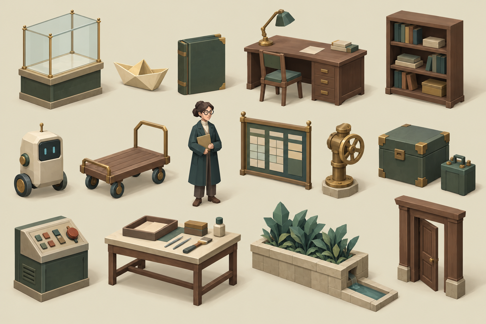

# 1편 — 박물관 오브젝트 제작 브리프

공통 스타일은 [시리즈 아트 디렉션](../../shared/art-direction.md)을 따른다. 이 문서는 1편의 실제 제작 기록이며, 다른 편의 제작에는 [반복 제작 절차](../../SERIES_ASSET_WORKFLOW.md)를 사용한다.

## 기술 기준

- 엔진: Three.js, 브라우저 WebGL, 절차적 메시. 공통 코어·소품·배우·환경 모델을 `public/assets/shared/core.mjs`, `public/assets/episodes/ep-01/props.mjs`, `actors.mjs`, `environment.mjs`로 분리하고 `public/museum-scene.mjs`에 연결했다.
- 장르/공간: 폐관 후 이어지는 소형 미스터리 박물관
- 카메라: 직교 투영, 기본 yaw 35도·pitch 43도. 사용자가 yaw 0~360도와 pitch 25~70도를 조절하므로 모든 방향에서 볼륨이 유지돼야 함
- 월드: 방 하나는 12 × 10 단위. 가구 높이는 대체로 0.7~2.3 단위. 새 방 출입구는 유효 폭 3.6·높이 2.30, 전체 문틀 높이 약 2.48 단위
- 렌더 예산: 공유 기본 지오메트리·재료, DPR 최대 1.5, 30fps 목표. 외부 텍스처와 실시간 그림자 없음
- 표현: 저폴리 절차 메시. 게임 내 화면 폭은 반응형이며 고정 픽셀 스프라이트 규격은 사용하지 않음
- 알파: 일반 메시 불투명. 유리·물만 제한적으로 투명 재료 사용
- 원점: 바닥에 닿는 오브젝트는 바닥 중앙, 테이블 위 소품은 받침면 중앙에 로컬 원점

## 시각 시스템

| 역할 | 색상 | 적용 |
| --- | --- | --- |
| 석회색 | `#e4dfc8` | 벽체, 도자기, 큰 중립 면 |
| 석재 테두리 | `#c3b99c` | 바닥 경계, 받침, 문턱 |
| 종이 | `#fff2c7` | 문서, 종이배, 작은 밝은 초점 |
| 접힌 종이 | `#c6aa78` | 종이 모서리와 접힘 |
| 목재 | `#704f40` | 가구와 오래된 구조물 |
| 황동 | `#b18a54` | 손잡이, 힌지, 배관, 식별 부품 |
| 박물관 녹색 | `#486252` | 천, 가구 포인트, 장비 케이스 |
| 짙은 녹청색 | `#243b37` | 화면, 배관 그림자, 깊은 값 |
| 먹색 녹색 | `#46594e` | 표식과 글자 |
| 물빛 | `#548a88` | 물, 유리의 보조색 |
| 제한된 녹 | `#9f5844` | 손상·주의·한두 곳의 따뜻한 강조 |

- **형태:** 큰 상자·원기둥·구·얇은 판을 조합한다. 주요 모서리는 완만하게 보이되 실제 면 수는 적게 유지한다.
- **실루엣:** 128px 썸네일에서도 기능이 구분되도록 핵심 부품을 과장한다. 소품 외곽은 단순하고 내부 디테일은 2~4개로 제한한다.
- **명암:** 왼쪽 위의 부드러운 따뜻한 광원 하나를 기준으로 한다. 메시 색과 재료의 거칠기로 읽히게 하고, 강한 발광은 상태 표시에만 쓴다.
- **재료:** 나무·종이·천은 무광, 황동은 낮은 금속성, 유리는 낮은 불투명도로 표현한다. 나뭇결·천결·때 자국 텍스처를 추가하지 않는다.
- **외곽:** 건축과 주요 가구는 짙은 녹색의 가는 그룹 외곽선으로 통일한다. 유리와 작은 금속 부품에는 외곽선을 붙이지 않는다.
- **그림자:** 접지 타원 또는 부드러운 바닥 면 하나로 무게를 전달한다. 개별 부품마다 그림자/광원을 만들지 않는다.
- **움직임:** 기본은 정지. 로봇의 작은 기울임, 인물의 고개·팔, 표시등 변화처럼 정체성을 돕는 짧은 움직임만 허용한다.

## 대표 시안



이 시트는 색·재료·형태 비율을 확인하는 **고정 카메라 컨셉 레퍼런스**다. 실제 게임에는 이 방향을 바탕으로 만든 32종 소품·가구, 4종 인물·단말, 7종 건축·표면 환경과 손상 종이배·번진 장부 2개 변형을 사용한다. 기본 모델 43종, 카탈로그는 45항목이다. 모두 Three.js 메시이며 카메라 yaw/pitch가 달라질 때 실시간으로 다시 렌더된다. 시트 자체는 `concept-only`이며 새 환경 7종을 포함한 실제 모델은 환경 확장 검수 뒤 `approved-in-game`으로 마감했다. 확인 범위는 [현재 환경 확장 검수](review/environment-upgrade/review.md)와 [이전 소품 검수 이력](review/review.md)을 따른다.

## 생성 기록

- 생성일: 2026-10-28
- 도구/모드: OpenAI 내장 `image_gen`, 새 이미지 생성. 별도 API/CLI와 외부 이미지 참조는 사용하지 않았다.
- 산출물: `assets/shared/references/museum-object-style-target.png`
- 아래 영어 문구는 최종 시트에 사용한 프롬프트의 핵심 조건을 보존한 요약 기록이다. 생성 모델 버전은 내장 도구에서 노출되지 않았다.

```text
Create a cohesive reference sheet for a small browser 3D museum mystery game:
empty glass exhibit case, folded paper boat, green ledger, archive desk and lamp,
book shelf, compact wheeled guide robot, wooden trolley, curator with teal coat
and glasses, schedule board, drain valve, green utility chest and battery,
industrial control panel, packing table and preservation tools, message terminal,
stone planter with folded leaves and drain, plain wooden doorway.
Use deliberately simple low-poly 3D geometry, broad flat surfaces, minimal bevels,
chunky silhouettes and sparse readable details. Render in orthographic three-quarter
view on a warm ivory background, with separated objects, consistent camera angle,
soft upper-left lighting and subtle contact shadows. Use the project's muted ivory,
paper cream, walnut, museum green, deep teal, dull brass, water teal and rust palette.
Avoid photorealism, busy texture, glossy plastic, saturated colors, labels,
captions, duplicate props, UI frames and watermarks.
```

실제 모델은 이미지 생성 결과를 변환한 파일이 아니라 프로젝트에서 작성한 절차적 기하다. 각 모델의 제작 경로, 측정 치수, 삼각형 수, 원점, 충돌 프록시는 [manifest](manifest.json)에 기록한다. 프로젝트 라이선스는 별도 확정되지 않았으므로 `project-license-not-set`으로 둔다.

## 공통 제작 카드

```text
Three.js 박물관 게임용 단일 저폴리 절차 메시를 만든다.
카메라 독립적인 완전한 3D 형상으로 만든다. 기준 뷰는 직교 사선이지만,
카메라 yaw 0~360도와 pitch 25~70도에서 앞·뒤·양 측면·상부가 자연스럽게 보이게 한다.
기준 팔레트: #e4dfc8, #c3b99c, #fff2c7, #704f40, #b18a54,
#486252, #243b37, #548a88, #9f5844. 재료는 무광이며 텍스처 노이즈는 없다.
큰 기본형과 적은 수의 기능 디테일을 사용하고, 외곽 실루엣을 먼저 읽히게 한다.
왼쪽 위의 부드러운 따뜻한 조명과 약한 접지 음영을 기준으로 한다.
카메라를 향해 돌리는 billboard, 한쪽 면 텍스처로 입체감을 가장하는 방식,
뷰 고정 그림자/하이라이트는 금지한다. 조명과 음영은 메시·재료·씬 조명이 만든다.
각 오브젝트는 로컬 원점, 실제 치수, 조사/충돌 역할을 분리해 구현한다.
글자·장식 라벨은 캔버스 재료로 별도 처리한다. 생성 텍스처 안에 글자를 굽지 않는다.
```

## 작업 규칙

1. 소품은 `public/assets/episodes/ep-01/props.mjs`, 배우와 원격 단말은 `public/assets/episodes/ep-01/actors.mjs`의 ID별 생성 함수로 관리한다. 공통 형태·자원 관리는 `public/assets/shared/core.mjs`를 사용한다.
2. `create(id, options)`는 `{ group, parts, footprint, height, pivot, collision }` 계약을 반환한다. 공유 재료/기하를 우선 사용하고 생성 함수에서 전역 씬 위치를 정하지 않는다. 원점 예외는 manifest의 `pivot`을 따른다.
3. 모델의 정적 외형, 애니메이션 상태, 조사/진행 상태를 분리한다. 서버 플래그의 진실을 메시가 자체 판단하지 않는다.
4. 게임 오브젝트의 충돌은 `group.userData.assetColliders`의 로컬 상자 목록을 사용한다. 정적 렌더 병합으로 충돌 영역을 추론하지 않는다.
5. 같은 패밀리의 상태 변형은 기준 메시의 비율·재료·카메라를 유지하고 한 가지 상태 차이만 추가한다.
6. 화면에서 128px와 실제 방 크기로 실루엣을 확인한다. 작은 문자와 0.03 단위 미만의 장식은 제거한다.
7. 대표 메시를 게임 씬에 붙인 뒤 정면/사선/축소 화면, 히트 영역, 메시 수를 확인해야 `approved-in-game`으로 바꾼다.
8. 카메라 yaw 0/90/180/270도와 pitch 25/43/70도 조합으로 회전 검수한다. 뒷면 누락·단면·종이처럼 얇아지는 부분·카메라에 고정된 장식이 없어야 한다.

## 현재 오브젝트 패밀리와 제작 가이드

| 패밀리 | 오브젝트 | 구분 신호와 제작 기준 | 상태/상호작용 |
| --- | --- | --- | --- |
| 전시 | 빈 유리 진열장 | 낮은 목재 받침, 가는 황동 기둥, 푸른 유리. 내부를 비워 둔다. | 조사 가능, 이동 충돌 |
| 전시 | 일정판 | 목재 프레임과 밝은 종이 면. 글자는 CanvasTexture에만 표시 | 조사 가능, 벽 부착 |
| 기록 | 기록 책상·독서등 | 넓은 목재 상판, 얇은 서류 더미, 황동 기둥과 작은 녹색 갓 | 조사 지점, 이동 충돌 |
| 기록 | 기록 서가·책 | 반복되는 낮은 책등 블록과 밝은 색인 띠. 책은 서가와 함께 묶음 | 배경 가구, 이동 충돌 |
| 기록 | 장부·겹표제·도장판·열쇠 | 손바닥 크기 평면 묶음, 한두 색 포인트. 정확한 글자는 네이티브 텍스트 | 조사 또는 퍼즐 상태 |
| 인물 | 안내 로봇 모로 | 석회색 몸통, 짙은 화면, 두 바퀴, 황동 집게·안테나. 얼굴 화면을 몸통과 분리 | 기울임/화면 상태, 충돌은 캐릭터 본체만 |
| 인물 | 윤서 | 짙은 녹청색 코트, 밝은 셔츠, 둥근 황동 안경과 명찰 | 짧은 머리·팔 동작, 이동 충돌은 발밑 영역 |
| 인물 | 원격 나래 초상 | 단말 화면 안에서만 보이는 평면 캐릭터. 방 안에 서 있는 인물처럼 배치하지 않음 | 메시 상태를 화면 표시로만 사용 |
| 운반 | 대차 | 낮은 목재 판, 네 바퀴, 황동 손잡이 | 모로 수면 상태에서만 표시 |
| 운반 | 포장대·보존 도구 | 목재 받침과 종이 포장 면. 도구는 밝은/어두운 색의 작은 실루엣 | 물품 구조 이후 상태는 게임 플래그에 연결 |
| 보관 | 잠긴 보관함·유리 덮개 | 두 개의 낮은 보관 베이, 고정된 격벽, 가는 유리판 | 플레이어 진입 금지, 상호작용은 지정 면에만 |
| 보관 | 종이배 | 접힌 삼각면이 겹친 밝은 실루엣, 접힘은 황토색 가는 선 | 온전/손상 변형. 전시 케이스에 되돌려 놓지 않음 |
| 보관 | 원본 장부 | 녹색 표지, 밝은 내지, 한 줄의 붉은 제본 | 온전/번짐/밀봉을 서로 다른 메시 상태로 관리 |
| 정비 | 밸브·배수로·접힌 잎 | 황동 바퀴, 어두운 직선 배수 홈, 평평한 쐐기형 잎 | 밸브 회전과 정비 플래그를 분리 |
| 정비 | 공구함·배터리 | 녹색 상자, 밝은 모서리, 짙은 배터리에 황동 단자 | 획득 상태만 플레이어와 함께 렌더 |
| 인양 | 제어판·표시등 | 목재/녹색 본체, 소수의 버튼, 작은 상태등 | 상태 색만 서버 공개 플래그에 연동 |
| 접수 | 원격 메시지 단말 | 나무 받침, 짙은 화면, 작은 녹색 화면 면 | 초상과 메시지 표시 상태를 분리 |
| 건축 | 문틀·기둥·벽체 | 석회색 벽, 목재 문짝, 얇은 상인방. 통행 폭은 비워 둠 | 충돌 형상은 메시와 별도 정의 |

## 카메라 회전 대응

모든 자산은 렌더 각도에 종속되지 않는 3D 모델이다. 정면만 모델링한 뒤 카메라를 향해 돌리는 보정은 하지 않는다. 얇은 표지판·화면·문서는 의미에 맞는 실제 판 두께와 후면 재료를 둔다. 양면 표시는 `DoubleSide`로 가릴 수 있지만, 실제 두께·뒷면 구조를 대신하지 않는다. 주요 가구와 인물은 앞/뒤 재료와 부품을 모두 만든다. 바닥 접지 그림자는 화면에 붙이지 않고 오브젝트 또는 씬 바닥 기준으로 둔다.

| 검수 yaw | pitch 25° | pitch 43° | pitch 70° |
| --- | --- | --- | --- |
| 0° | 전면/상부 | 기준 각도 | 상부 가림 검사 |
| 90° | 측면 깊이 | 측면 실루엣 | 수평 두께 검사 |
| 180° | 후면 완결성 | 뒷면 상태 | 후면 상부 가림 |
| 270° | 반대 측면 | 반대 측면 디테일 | 반대편 두께 |

전체 조합 검수 후 기준 각도에서만 완성도가 높고 회전 시 빈약해지는 모델은 반려한다. 그림자·발광·텍스트 면이 메시와 함께 움직이는지, 접지 피벗과 월드 크기가 유지되는지 확인한다.

## 모델 확인

`npm run build`와 `npm start` 후 `/asset-gallery.html`을 열면 게임과 같은 생성 함수를 사용하는 회전 갤러리를 볼 수 있다. 모델 45개 항목을 선택하고 드래그·45도 회전 버튼·25/43/70도 높이·자동 회전·확대·와이어프레임·법선 보기로 확인한다. 개별 모델 검수 후 게임의 방 배치·가림·상태 변화도 별도로 확인한다.


## 추가 환경 패밀리

새 환경 revision은 `museum-environment-2026-10-28`이다. 방·복도 구조와 안뜰 길·물길·관장실/로비 깔개·제어실 정비 띠·젖은 바퀴 자국을 같은 재료·bevel 규칙의 7개 생성기로 통일했다. 실제 방과 통로의 위치·연결은 기존 지도 데이터를 따른다. 복도 입력의 16단위 연결 사각형에서 방과 겹치는 부분은 렌더하지 않고, 실제 노출 간격 가로 4·세로 6 단위만 모델링해 바닥 중첩을 막는다. 방 출입구의 폭 3.6·높이 2.30을 확보해 캐릭터의 보행과 머리 공간을 구분해 검수한다.

새 환경의 기본 옵션·실측 bounds·삼각형 수·충돌 프록시와 실제 9개 방/12개 연결 문맥은 [manifest](manifest.json)에 별도로 기록했다. 기존 38항목·912뷰·81개 테스트 기록은 이전 소품 검수 이력이며 새 환경의 검수 완료 숫자로 바꾸지 않는다. 추가 환경을 포함한 전체 45항목의 최종 검수는 [환경 확장 기록](review/environment-upgrade/review.md)과 [측정 JSON](review/environment-upgrade/verification.json)에 연결했다. 전체 자동 렌더 1,080뷰·방 배치 108뷰, 상태 4종·확대 12회·모션 7샘플과 실제 조사·대화·이동·카메라 조작을 확인했고 테스트 103개가 통과했다. 대표 contact sheet·건축 회전 모음·실제 게임 화면을 별도 수동 확인했으며, 모든 1,080장을 각각 육안 검수한 것으로 표현하지 않는다.

문자 CanvasTexture, 선택·목적지 표시, 접지 그림자와 WebGL 불가 시 접근 가능한 대체 표시는 기능별 표현이다. 정상 3D 씬의 가구·배우 모델과 건축·표면 환경은 에셋 생성기로 구성한다.
