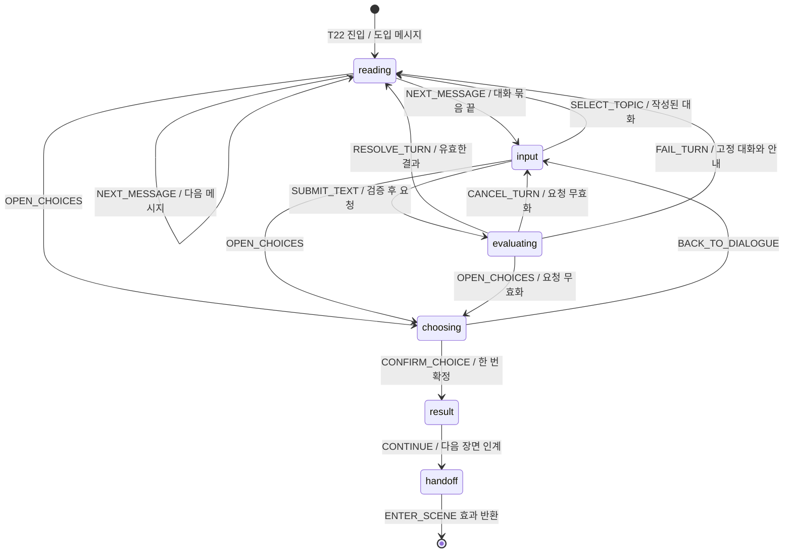

# 메시지 게임의 상태·사건·시나리오 계약

대화는 충분히 읽고 되짚을 수 있게 만들고, 증거 획득·사실 인정·장면 이동은 검증된 사건을 통해서만 바꾼다. 같은 초기 상태와 확정 사건 기록으로 같은 진행 결과를 재현하는 것이 이 설계의 목적이다.

**T22 범위 구현 완료.** 사용자가 이 계약을 검토하고 ‘T22 상태머신부터 구현’을 선택했다. 메시지 읽기·단서 추궁·네 행동·다음 장면 인계·사건 재생을 구현했다. [실행한 메시지 기록](../../artifacts/t22-demo.md)에서 결과를 읽을 수 있다. 기존 `src/engine.js`는 12단계 옛 초안 그대로이며, 새 구현은 `src/game-state.mjs`와 `src/t22-dialogue.mjs`다. 전체 21장면이나 웹/API 연결의 완료를 뜻하지 않는다.

## 1. 구현 범위와 대안

첫 구현은 화면과 유료 API 없이 **T22 진입 → 메시지 읽기 → 질문/증거 제시 → 판정 결과 처리 → A~D 확정 → 결과 읽기 → D21/D22로 나가기**를 실행하는 순수 상태 전이와 시나리오 테스트다. NPC 판정과 생성 응답은 외부 협력자로 주입하고, 테스트에서는 고정 응답을 사용한다. 판정기 자체를 검증했다고 주장하지 않는다.

기존의 ‘선택하면 step을 하나 올리는’ 구조는 대화 대기·취소·결과 읽기를 표현하지 못하고, 이미 들은 사실과 소지품도 구분하지 않는다. 단계 숫자에 여러 플래그를 더하는 대신 진행 상태를 명시한다.

| 대안 | 판단 |
| --- | --- |
| AI가 매 턴 다음 상태와 경로를 자유롭게 생성 | 사건의 진실과 엔딩 조건을 재현하기 어려워 채택하지 않는다. |
| 모든 자유문장을 키워드/정규식으로 분류 | 부정·인용·없는 증거를 가진 척하는 말을 구분하기 어려워 추궁 판정에 쓰지 않는다. |
| 명시적 상태 전이 + ID와 조건으로 규칙 매핑 + AI 해석 후보 검증 | 추천. 확정된 규칙은 재현할 수 있고, 자유 질문은 인물에 맞게 받을 수 있다. |

첫 구현에는 새 상태머신 라이브러리나 Agent 프레임워크를 추가하지 않는다. Node의 표준 테스트 러너와 작은 전이 함수로 계약을 증명한다. 웹 표현과 실제 API 연결은 이 흐름을 확인한 뒤 붙인다.

**호환성:** 옛 `museum-1` 저장은 새 설계로 자동 변환하지 않는다. 당시 단서·단계·엔딩 의미가 다르기 때문이다. 첫 구현은 명시한 T22 진입 자료만 받으며 전체 게임 저장/복원 완료를 주장하지 않는다. 옛 소스나 사용자 파일을 삭제하지 않는다.

## 2. 상태에 담을 것

| 항목 | 의미와 불변 조건 |
| --- | --- |
| storyVersion / rulesVersion | 원고·전이 규칙 버전. 기록 재생은 같은 버전을 요구한다. |
| teamId / sceneId / sceneRevision | 독립 팀과 현재 장면. 장소를 옮길 때 장면 버전이 바뀐다. |
| phase | 첫 구현은 reading / input / evaluating / choosing / result / handoff 중 하나. handoff는 T22 처리가 끝난 상태이며 전체 게임의 ended와 구분한다. |
| evidence | 실제 보존한 자료 ID 집합. 문장에 자료 이름이 등장했다는 이유로 추가하지 않는다. |
| resources | 배터리·지도 등 실제 획득한 준비물. 같은 비상 배터리를 두 개로 만들지 않는다. |
| knownFacts | 이미 직접 들었거나 확인한 사실 ID 집합. 문서 소유와 구분하며, 장면이 합류해도 유지한다. |
| activeClaimId | NPC가 현재 실제로 말한, 반박 가능한 주장. 알려진 사실과 모순되는 주장을 새로 제시하지 않는다. |
| messages / readingPosition | 화자·본문·메시지 ID·연결된 사실 ID와 읽는 위치. 과거 대사를 몰래 바꾸지 않는다. |
| pendingRequest | evaluating일 때만 존재하는 요청 ID·팀·장면 버전·요청 당시 자료. 동시에 하나만 처리한다. |
| committedChoice / nextSceneId | result일 때의 확정 행동과 다음 장소. 결과를 읽는 동안 같은 행동을 다시 실행하지 않는다. |
| eventSequence | 확정 사건의 순서. 읽기 시각이나 실제 경과 시간으로 엔딩이 달라지지 않는다. |

T22의 `knownFacts` 예: `request_received`, `return_delayed`, `return_clause_removed`. I04에서 들은 수신 인정은 `request_received`로 이어받는다. 요청서를 챙기지 않아도 이미 들은 말은 남는다.

`request_received`는 서명 자료 `statement`와 다르다. A를 확정할 때 규약과 안내를 대조하는 작성된 결과를 거쳐, 규약 변경과 요청 지연을 명시한 서명 자료를 얻는다. 단순 수신 인정만으로 공식 시정 증거를 만들지 않는다.

## 3. 상태 전이

T22의 실제 목적지는 D21 또는 D22다. 첫 구현은 handoff 상태와 ENTER_SCENE 효과를 반환한다. D21/D22의 실제 대화 시작과 전체 게임 종료 상태는 후속 구현 범위다.

| 현재 상태 / 사건 | 조건 | 결과 |
| --- | --- | --- |
| reading / NEXT_MESSAGE | 현재 묶음에 읽을 메시지가 있음 | 위치만 전진. 마지막 메시지 뒤 input. 소지품 변화 없음. |
| input / SELECT_TOPIC | 현재 공개 단계에 허용된 주제 ID | 해당 작성 대사 묶음으로 reading. 필요한 사실 공개만 적용. |
| input / SUBMIT_TEXT | 입력 길이·증거 보유·장면·호출 한도 유효 | evaluating. 요청 효과를 반환하고 외부 호출은 실행 계층이 담당. |
| evaluating / RESOLVE_TURN | 요청 ID·팀·장면 버전 일치, 형식/허용 사실 검증 성공 | 승인된 대사와 사실을 한 번 반영해 reading. |
| evaluating / FAIL_TURN | 현재 요청의 실패 | 요청을 끝내고 고정 대사/질문으로 reading. 새 증거·경로 보상 없음. |
| evaluating / CANCEL_TURN | 현재 요청 ID 일치 | pending 제거, 취소 효과 반환, input. 나중에 온 응답은 무효. |
| reading,input,evaluating / OPEN_CHOICES | 모험 진행 중 | choosing. 대기 중 요청은 취소한다. 대화를 읽은 것으로 위조하지 않는다. |
| choosing / CONFIRM_CHOICE | 현재 장면의 A~D 중 하나, 장면 버전 일치 | 규칙 결과·소지품·결과 대사·다음 장소를 원자적으로 확정해 result. |
| result / CONTINUE | 결과 묶음 확인 완료 | 다음 장면 ID와 버전, ENTER_SCENE 효과를 반환하며 handoff. 단서와 알려진 사실은 유지. |
| handoff / 상태 변경 사건 | 항상 거부 | 기록 유지, `SCENE_HANDOFF`. 다음 장면 처리기로 인계해야 한다. |
| 모든 상태 / 정의되지 않은 사건 | 해당 phase에 불허 | 상태를 바꾸지 않고 `EVENT_NOT_ALLOWED`와 가능한 행동 반환. |

읽기를 건너뛰는 경우에는 ‘행동 선택으로 이동’을 명시적으로 누른다. 숨은 타이머나 자동 넘김으로 choosing에 보내지 않는다. 소리·타이핑 연출 없이도 모든 사건을 이해할 수 있어야 한다.

## 4. 결정론적 패턴 매핑

여기서 패턴은 **현재 장면 + 실제 공개 주장 + 선택한 자료 + 검증된 의도**의 조합이다. 자연어 문자열 그 자체를 상태 변경 명령으로 사용하지 않는다.

| 입력/조건 | 확정할 사건 또는 응답 | 바뀌는 것 |
| --- | --- | --- |
| T22에서 ‘박물관을 닫는 이유’ 주제 ID 선택 | 해당 원고 ID를 읽기 목록에 추가 | 메시지와 읽기 위치 |
| `no_request` + 보유한 `request` + 근거 있는 반박으로 확인된 후보 | `request_received`와 `return_delayed` 인정, 작성된 핵심 인정 문장 연결 | 알려진 사실·현재 주장·대화 기록 |
| 이미 `request_received`를 알고 있음 | ‘수신 사실’ 추궁을 다시 성공 처리하지 않고 ‘미룬 이유’ 대화로 연결 | 중복 보상 없이 응답만 추가 |
| 닳은 열쇠 관찰 + ‘최근 사용 증명’ 주장 | 근거 부족에 대한 작성된 해명 | 메시지, 최근 사용 사실은 미확정 |
| 보유하지 않은 자료 ID 제출 | `EVIDENCE_NOT_OWNED` | 변화 없음. 현재 기록장에서 고르도록 안내 |
| “서명해 주세요”라는 자유문장 | 행동 요청으로 안내 | A 선택 안내. 아직 아이템·장면 변화 없음 |
| choosing에서 A 확정 | 기존 T22-A 규칙 적용 | 서명 자료 + 결과 메시지, 다음 장소 D21 |
| choosing에서 B/C/D 확정 | 기존 선택 규칙 적용 | 각각 요청서/배터리/도면, 다음 장소 D21/D22/D22 |
| 장면 이동 후 이전 요청 결과 도착 | `STALE_RESPONSE` | 변화 없음 |

적용 순서: **팀·장면·요청 검증 → 이미 확정된 사실 확인 → 실제 자료와 주장 조합 확인 → 허용된 결과 매핑 → 상태와 사건 기록 동시 반영**. 두 규칙이 같은 조건에 서로 다른 결과를 내면 콘텐츠 검증 오류로 보고한다. 우연히 먼저 실행된 규칙을 정답으로 삼지 않는다.

자유문장은 AI 해석이 필요할 수 있다. 같은 문장이어도 매번 같은 모델 판정이 나온다고 보장하지 않는다. 원고 버튼은 ID로 바로 매핑하고, AI의 판정은 외부 입력 후보로 취급한다. 모호하면 확인 질문 또는 고정 대화로 돌아가며, 평가하지 않은 신뢰도 숫자로 상태를 변경하지 않는다.

## 5. 함수 계약과 경계

구현한 핵심 계약은 `transition(state, event) → { ok: true, state, effects } | { ok: false, error: { code, message } }`다. 동기 함수이며 입력 상태와 사건을 변경하지 않는다. 시간·난수·네트워크·DOM·저장소를 직접 읽지 않는다. 첫 구현의 효과는 INTERPRET_TURN, CANCEL_REQUEST, ENTER_SCENE이며 실행 계층이 처리할 정보만 반환한다.

현재 RESOLVE_TURN은 판정/화제/행동 요청 후보를 받아 허용된 작성 대사로 매핑한다. 자유 생성 대사나 실제 Decisions 응답을 직접 연결한 상태는 아니다. 실제 API 어댑터에서 자료 ID를 서버의 원문으로 해석하고, 응답을 이 계약에 맞춰 검증하는 일은 후속 범위다. 서버 인증과 저장소도 아직 없다.

- 외부 입력은 경계에서 한 번 검증한다. 사용자 문장은 공백 제거 후 1~600 유니코드 코드포인트, 선택 자료는 턴당 0~1개, 선택 ID는 현재 장면의 A~D다. 수치는 첫 구현용 제안이다.
- 요청 ID는 호출자가 전달하고 한 팀에서 한 턴만 진행한다. 같은 요청 ID의 재전송은 새 호출이나 보상을 만들지 않는다. 다른 내용에 같은 ID를 재사용하면 `REQUEST_ID_CONFLICT`로 거부한다.
- 모델 후보에는 허용한 사실 ID·동작 ID만 사용할 수 있다. 자유 생성 대사의 사실 일치는 스키마만으로 보증할 수 없으므로 핵심 인정은 작성된 문구로 표시하고, 모순 검출/실제 모델 평가는 별도로 수행한다.
- 요청 취소 뒤 늦은 응답, 다른 팀 응답, 이미 처리한 응답은 현재 상태를 바꾸지 않는다. 장면 이동 전후 경합도 하나의 팀별 사건 순서로 처리한다.
- 서버가 실제 상태를 소유한다. 브라우저가 `request_received`나 `statement`를 JSON에 써 보냈다고 인정하지 않는다. 첫 순수 함수 샘플의 테스트 입력은 운영 서비스의 인증을 대체하지 않는다.
- 결과가 실패하면 이전 상태를 유지한다. 빈 입력·길이 초과·자료 미보유 등 오류는 해당 입력과 고칠 방법을 알려 준다. 로그에 API 키나 전체 사용자 문장을 그대로 남기지 않는다.
- 지원하지 않는 저장/규칙 버전, 손상된 사건 기록은 복원 실패다. 부분 상태를 적용하지 않는다. 전체 저장 형식 구현은 후속 범위다.

## 6. 사용자 시나리오와 테스트의 대응

| ID | 사용자가 겪는 상황 | 입력 사건과 확인할 결과 |
| --- | --- | --- |
| US01 | 대사를 읽고 기록장을 다시 본다 | NEXT_MESSAGE는 읽기 위치만 바꾼다. 기록 열람이 자원이나 시간을 소비하지 않는다. |
| US02 | 요청서를 제시해 거짓 설명을 짚는다 | 실제 보유 자료 + 유효한 판정 → 구두 인정, `statement` 없음. |
| US03 | I04에서 이미 수신 인정을 들었다 | 요청서 소지 여부와 무관하게 T22의 수신 부인 대사 제외. |
| US04 | 열쇠만 보고 최근 사용을 단정한다 | 해명 메시지는 나오지만 최근 사용 사실·보상은 생기지 않는다. |
| US05 | 대화를 길게 읽고 추가 질문한다 | 작성 대사 수와 API 호출 수는 별도다. 한 응답의 여러 말풍선을 여러 호출로 세지 않는다. |
| US06 | A를 선택하고 결과를 읽는다 | 서명 자료는 정확히 한 번 획득. result에서 재확정 거부. CONTINUE 뒤 D21. |
| US07 | C를 선택해 배수 조사로 향한다 | 배터리 확보 후 D22, 구두 인정은 유지, 서명은 자동 지급하지 않음. |
| US08 | 제출을 두 번 누른다 | 같은 요청은 한 번만 처리. 같은 ID/다른 내용은 명시적 실패. |
| US09 | 응답을 기다리다가 행동 선택으로 넘어간다 | 요청 무효화 후 choosing. 이전 응답이 도착해도 상태 불변. |
| US10 | 서비스가 끊기거나 한도를 소진한다 | 고정 질문과 A~D로 진행. 실패를 자백이나 보상으로 처리하지 않음. |
| US11 | 다른 팀에서 같은 NPC를 만난다 | 팀 A의 인정·자료·대화가 팀 B에 반영되지 않음. |
| US12 | 저장된 확정 사건을 다시 재생한다 | 같은 버전/초기 상태/사건 목록 → 같은 상태와 메시지 기록. API 재호출 없음. |
| US13 | 종료 후 입력하거나 잘못된 자료 ID를 보낸다 | 안정적인 오류 코드와 상태 불변. 사용자 입력으로 프로세스를 중단하지 않음. |

US01~US10과 T22에 해당하는 US11~US13의 경계 사례를 첫 구현의 표 기반 테스트로 둔다. 입력 상한의 0/1/600/601, 결과 순서 변경, 중복, 취소, 알려진 사실과 자료의 서로 다른 조합을 포함한다. 미구현인 전체 게임 종료·저장 시스템까지 통과했다고 보고하지 않는다.

## 7. 기록으로 재현하는 방식

기록에는 사건 순서, 팀·장면, 적용한 규칙 ID/버전, 승인한 판정 결과, 표시한 메시지 본문, 실제 상태 변화를 남긴다. API에 같은 질문을 다시 보내는 것은 재현이 아니다. 확정 당시 결과를 재적용해야 모델 버전이나 생성 표현이 달라져도 같은 진행을 되짚을 수 있다.

사용자에게는 대화와 선택 기록을 보여 준다. 요청 ID·판정 확률·내부 상태 이름은 일반 플레이 화면에 표시하지 않는다. 개발 검증에서는 두 번 재생한 상태와 외부 효과의 순서를 비교한다. 저장 실패 시 진행/저장 성공을 혼동하지 않도록 안내하는 것은 실제 저장 계층을 붙일 때 함께 구현한다.

## 8. 첫 구현의 파일과 완료 기준

| 파일 제안 | 책임 |
| --- | --- |
| `src/game-state.mjs` | 검증된 사건의 전이와 T22 행동 적용. 하나의 canonical 전이 함수, 입력 불변, I/O 없음. |
| `src/t22-dialogue.mjs` | 승인된 원고·화제·공개 조건. 기존 [T22 콘티](t22-storyboard.md)의 대사를 이곳으로 옮길 때 원고 중복 관리를 끝낸다. |
| `tests/game-state.test.mjs` | 위 사용자 시나리오와 실패/중복/재생 사례. 실제 전이 함수를 실행하고 외부 판정만 고정한다. |

검증 결과는 [검증 문서](validation.md)에 기록했다. 추가 의존성 없이 Node 표준 테스트를 사용했고, 이미 설치된 TypeScript와 ESLint로 새 소스의 타입·포맷·정적 검사를 수행했다. 저장소에는 package.json과 웹 빌드 설정이 없으며 배포 빌드는 수행하지 않았다. 사용자의 후속 지시에 따라 검증을 더 확대하지 않고, 이후에는 핵심 진행·단서·중복/취소 사례에 집중한다.

완료 기준은 T22의 대화와 네 행동이 이 계약대로 재현되고, 잘못된 입력·취소·오류·중복에도 진행 상태가 일관적인 것이다. 전체 21장면 게임, 실제 AI 품질, 웹 화면, 배포 완료와는 구분한다.
