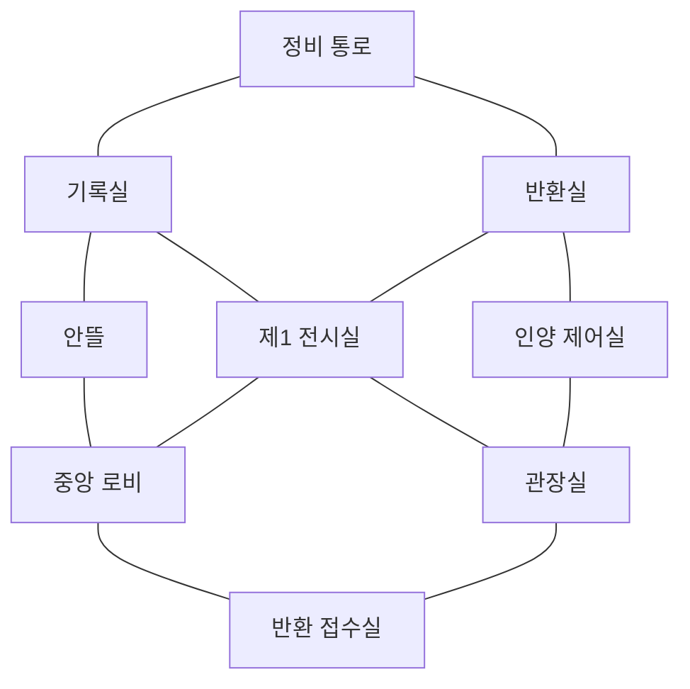

# 연결된 박물관에서의 플레이

새 게임은 아홉 공간이 복도로 연결된 하나의 박물관에서 시작한다. 팀 캐릭터를 직접 움직여 사물과 인물을 만나고, 조사한 내용으로 퍼즐과 이야기의 결정을 진행한다.

## 공간

공간·복도 좌표와 장면 배치는 `public/museum-map.mjs`가 유일한 기준이다. 각 방은 12×10 단위이며 방 사이 간격은 16, 복도 폭은 3.6이다. 천장을 걷어낸 시점에서 현재 위치와 출입구를 볼 수 있다.

| 공간        | 이야기 장면과 주요 행동                                                                             |
| ----------- | --------------------------------------------------------------------------------------------------- |
| 제1 전시실  | S01 · 빈 진열장과 모로, 일정을 조사하고 첫 방향을 정한다.                                           |
| 정비 통로   | I01, F33 · 모로의 접수표·장비 확인, 마지막 이동 인계.                                               |
| 기록실      | I02, P11, F32 · 표제 조사, 도장 퍼즐, 확보한 자료로 정정.                                           |
| 안뜰        | I03, D22 · 물자국 조사, 배수선·보조 레일 준비.                                                      |
| 관장실      | I04 · 열쇠와 접수 서류를 두고 윤서와 대화.                                                          |
| 중앙 로비   | P12, F34 · 운반 통로 지도 퍼즐, 마지막 현장 인계.                                                   |
| 반환실      | S12, T21, T22, D21, S22, R31, R32 · 이송의 진실, NPC 추궁, 원본과 사본 대조, 구조 대상과 전원 선택. |
| 인양 제어실 | P21 · 안전 순서를 직접 예약하고 제출.                                                               |
| 반환 접수실 | S31, F31 · 나래와 메시지, 배의 반환·수리·인계.                                                      |

퍼즐의 운반 통로 지도는 침수 구역 내부 설비를 나타낸다. 플레이어가 걷는 안전한 관람 복도와 구분한다. 가 보지 않은 방의 장식은 볼 수 있어도 미래 장면의 단서와 대사는 공개하지 않는다.

## 입력과 피드백

- WASD/방향키 또는 바닥 클릭·터치로 이동한다. 벽과 바깥 공간은 통과하지 않는다.
- 사물과 인물에 가까이 가서 E 또는 조사 버튼을 사용한다. 멀리 있는 조사 대상을 누르면 먼저 그곳까지 걸어간다.
- 미니맵에서 현재 위치와 이야기의 다음 목적지를 확인한다. M 또는 지도 버튼으로 크게 볼 수 있다.
- 사물 조사는 자동 클로즈업으로 전환하고 현장으로 돌아가면 보행 구도로 복귀한다. 사용자 확대·회전·시선 높이는 이 전환과 합성한다. 휠, 우클릭/Shift 드래그, 두 손가락 확대·이동, 시점 조절 버튼을 지원한다. 수동 확대는 0.6–1.8배, 최종 확대는 최대 4배, 시선 높이는 25–70도다. 기본값은 1배·회전 35도·높이 43도이며 초기화할 수 있다.
- 대화·퍼즐·입력창 안에서는 보행 키가 인물을 움직이지 않는다. 모바일도 드래그 정밀도나 빠른 입력이 필요하지 않다.
- 주요 선택이 다른 장소를 지정하면 이동 단계에 들어간다. 도착해야 그곳의 도입과 조사를 시작한다. 같은 장소의 다음 대화는 불필요하게 재이동하지 않는다.

## 상태와 저장

현재 기본 버전은 `museum-map-4`다. 로비 O00에서 초대장과 윤서를 확인하고 전시실로 걸어간다. 이전 지도판 `museum-map-3`, 조사판 `museum-play-2`, 읽기판 `museum-full-1`은 각 버전의 시작·조사 규칙으로 이어본다. 새 게임은 별도 세션을 만들며 기존 기록을 보존한다. 도입과 첫 발견의 공개 순서는 [도입 수정 계획](onboarding-revision.md)에 정의한다.

지도판의 상태는 `travelling → reading → exploring/input → choosing 또는 퍼즐 제출 → result`로 이어진다. 다른 방으로 가는 `CONTINUE`는 목적지를 지정하고, `ARRIVE {roomId}`가 그 목적지와 일치해야 도입을 공개한다. 잘못된 방, 낡은 revision, 이동 중 조사·선택은 거절한다. 엔딩은 마지막 행동을 한 방에서 읽는다.

보행 좌표·카메라와 이야기 상태·목적지·도착 여부를 모두 브라우저가 소유한다. 화면은 보행을 관리하고 로컬 상태머신이 이야기 전이를 검증하며, 별도 게임 서버에 요청하지 않는다. 다시 열면 마지막 도착 방에서 시작하며, 이동 중 저장은 출발 방에서 목적지까지 다시 걷는다. 이는 경쟁 게임의 위치 인증 기능이 아니다.

## 퍼즐과 조사

전체 본문은 21개 장면의 사물별 대사로 나눠 보존한다. 필수 단서만 진행 조건으로 사용하며 모든 장식을 누르는 과제로 만들지 않는다. 조사 완료 메모는 다음 장소에서도 기록장에 남는다.

1. **도장 배열:** 네 도장을 빈 칸에 직접 놓고 위치를 바꾼다. 네 조건을 만족하면 정비 도면을 확보한다.
2. **운반 경로:** 지도에서 장소를 이어 침수 구간을 피하는 최단 경로를 만든다.
3. **인양 예약:** 유입 차단·레일 고정·함 인양·전원 해제를 직접 배열한다. 오답은 안전 장치가 막고 수동 복구로 이어진다.

네 개의 추리 대조는 잘못된 해석을 고칠 수 있다. 퍼즐은 제출 전 자유롭게 고치고, 최종 제출 뒤에는 그 결과로 진행한다. 준비된 힌트에 벌점은 없다. NPC 대화는 장면별 작성된 질문과 보유 단서에 맞는 추궁을 사용한다. AI 자유 질문이나 외부 API 호출은 없다.

## 이야기가 공간을 이끄는 방식

1장은 빈 진열장과 젖은 흔적에서 시작한다. 모로가 남긴 접수표, 덧붙인 표제, 물자국, 윤서의 열쇠 중 팀이 고른 실마리를 따라 각 방을 찾는다. 퍼즐은 운송 기록과 시설 운반로를 확인하는 작업이다. 얻은 도면과 기록을 갖고 반환실에서 두 사람의 설명을 대조한다.

2장은 누가 옮겼는지에서 왜 돌려주지 않았는지로 질문을 옮긴다. 반환실의 원본 함과 단말 사본은 서로 다른 조사 대상이다. 나래의 사연은 원래 기록을 읽은 뒤 반환 요청과 윤서의 인정을 듣고, 그 뒤 구조 준비로 이어진다. 이 핵심 장면의 조사 순서는 브라우저 상태머신에서도 보장한다.

3장은 알게 된 진실을 행동으로 옮긴다. 인양 제어실에서 준비한 순서가 반환실의 구조 방법으로 이어지고, 확보한 배·장부와 모로의 전원 상태가 이후 대사와 마지막 인계에 반영된다. 결말은 물건을 얻었다는 사실뿐 아니라 내일의 약속과 누가 책임지고 전달하는지를 마무리한다.
