# T22 대화 콘티 — “받은 적 없다”는 말

팀이 직접 고른 단서로 관장의 말을 바꾸고, 그 인정을 기록으로 남길지 구조 장비를 먼저 챙길지 결정하는 장면이다.

**검토용 원고와 연출 제안.** 아래 대사는 작가가 작성한 예시이며 모델 출력이나 실행 화면이 아니다. NPC 대화·추궁이라는 방향은 사용자와 합의했지만, 이 원고와 연출은 검토 전이다. 전체 이야기 구현을 재개한 것은 아니다.

후속 승인으로 T22 메시지와 상태 전이를 구현했다. **실행 대사의 기준은 [t22-dialogue.mjs](../../src/t22-dialogue.mjs)**이며 이 콘티는 연출 검토용이다. 구현 결과를 확인할 때에는 해당 소스에서 생성한 [메시지 실행 기록](../../artifacts/t22-demo.md)을 사용한다.

## 1. 이 장면까지 온 길

예시 경로: `S01-C → I03-C → P11-A → S12-C → T22`.

- 팀은 안뜰의 접수 단말에서 수신 확인이 찍힌 반환 요청서를 보존했다.
- 모로가 배를 옮겼다는 말과, 윤서가 그 설명을 끊으려는 모습을 봤다.
- 윤서는 이 팀 앞에서 아직 요청을 받았다고 인정하지 않았다.
- 목표는 배의 행방과 처리 경위를 확인하는 것이다. 관장의 마음을 읽거나 말투를 평가하는 게임은 아니다.

**다른 경로의 입장:** I04를 거쳤다면 이미 수신을 인정받았다. 이 경우 첫 부인은 생략하고 “요청은 받았어요. 하지만 마지막 전시까지는 남아 있어야 한다고 생각했어요”로 이어진다. 요청서를 챙기지 않은 I04-C/D에서도 동일하다. 이후 질문은 받은 사실이 아니라 반환을 미룬 이유를 다룬다.

### 메시지로 읽는 방식

음성 없이 화자 이름이 붙은 메시지와 짧은 행동 묘사로 진행한다. 인물들은 박물관에서 마주 보고 대화하는 설정이며, 말풍선 표현 때문에 모두 휴대전화로 채팅하는 설정으로 바꾸지는 않는다.

아래 **팀** 대사는 선택한 질문 또는 직접 입력한 문장의 예시다. 플레이어가 하지 않은 질문을 자동으로 발송하지 않는다. 작성된 화제를 고르면 이어지는 NPC 메시지 묶음을 읽고, 자유 입력을 하면 그 질문에 맞는 응답을 받는다. 모든 질문을 정해진 순서대로 통과해야만 추궁할 수 있는 것은 아니다. 처음부터 증거를 짚은 팀에는 앞선 탐색 대화를 강제로 읽히지 않는다.

한 말풍선은 보통 1~3문장으로 나누되, 같은 뜻을 여러 말풍선으로 늘리지 않는다. 다음 메시지는 독자가 넘기며 이전 대화는 기록에서 다시 읽을 수 있다. 글자별 출력·가짜 타이핑 대기·자동 넘김을 필수로 두지 않는다. 메시지를 읽는 동안 인물의 자세와 시선으로 감정을 보조한다.

## 2. 순서대로 읽는 장면

### 컷 1 — 대답 대신 돌아오는 질문

모로가 말을 멈춘다. 윤서는 손에 쥔 열쇠를 내려다보다가 방문객 쪽으로 몸을 돌린다.

> **윤서:** “마지막 전시예요. 이곳에 무엇이 남아 있었는지, 한 번은 더 보여 주고 싶었어요.”
>
> **팀:** “그래서 모로의 설명을 막으신 건가요?”
>
> **윤서:** “배를 옮겼다는 말만 들으면, 다들 모로가 훔쳤다고 생각할 테니까요.”
>
> **팀:** “끝까지 설명하게 두면 됐잖아요.”
>
> **윤서:** “그 애는 자기가 한 일을 순서대로 말해요. 그게 사람들에게 어떻게 들릴지는 생각하지 않고요.”
>
> **팀:** “그럼 관장님이 알고 있는 순서부터 듣죠. 배는 왜 진열장에 없나요?”
>
> **윤서:** “제가 옮기라고 한 건 아니에요.”
>
> **팀:** “관장님 말고 누군가 요청했을 수도 있겠네요.”
>
> **윤서:** “돌려달라는 연락은 받은 적 없어요. 모로가 혼자 움직인 거예요.”

처음에는 모로를 감싸는 듯했던 말이 책임을 모로에게 미루는 말로 바뀐다. 화면이 이 해석을 대신 결론 내리지는 않는다. 플레이어는 대화를 되짚거나, 지금 기록장을 열거나, 다른 화제를 물을 수 있다. 읽는 동안 카메라는 머문다.

### 컷 2 — 팀이 발견하는 어긋남

기록장의 **반환 요청서**를 펼치면 두 부분이 보인다.

> **나래의 요청:** 내일 아침 9시, 이웃들과 배를 띄우기로 했습니다. 그전에 제1호 종이배를 돌려받고 싶습니다.
>
> **접수 기록:** 전날 접수 · 수신 확인: 윤서

방금 들은 “받은 적 없다”와 나란히 읽을 수 있다. 화면이 자동으로 ‘거짓말 발견’을 선언하지는 않는다. 팀원들이 어느 부분을 물을지 정하고, 대표가 요청서를 선택한 뒤 입력한다.

> **팀:** “요청서에 관장님 수신 확인이 있는데요. 못 받았다는 말과 다르잖아요.”

이 문장은 정답 암호가 아니다. “여기 직접 확인하셨네요?”처럼 짧게 지적해도 같은 사실을 묻는지 판정한다. 입력창에는 어떤 문서를 함께 보내는지 표시한다.

### 컷 3 — 받은 편지와 하지 않은 답장

윤서가 선택한 문서 쪽으로 시선을 내린다. 쥐고 있던 열쇠를 내려놓는다.

> **윤서:** “……제 확인이 맞아요.”
>
> **팀:** “그러면 연락은 받은 거네요.”
>
> **윤서:** “받았어요. 내일 배를 띄우고 싶다고 적혀 있었죠. 읽고도 처리를 미뤘습니다.”
>
> **팀:** “나래 씨한테 기다려 달라고 하셨나요?”
>
> **윤서:** “아니요. 말하지 않았어요.”
>
> **팀:** “그럼 나래 씨는 요청한 대로 돌려받을 거라고 생각하고 있겠네요.”
>
> **윤서:** “그랬겠죠. 저는 마지막 전시가 끝난 다음에 생각하려고 했어요.”
>
> **팀:** “아침 아홉 시에 필요하다고 적혀 있는데도요?”
>
> **윤서:** “그 문장을 안 읽은 게 아니에요. 읽고도, 오늘까지는 여기 있어 줬으면 했어요.”

윤서의 손이 빈 진열장 쪽으로 움직이다가 멈춘다.

> **팀:** “배 한 척이 그렇게 중요했나요?”
>
> **윤서:** “첫 전시품이니까요. 여기가 아직 박물관 같아 보이려면, 적어도 저 자리는 채워져 있어야 한다고 생각했어요.”
>
> **팀:** “돌려준 자리라고 설명할 수도 있잖아요.”
>
> **윤서:** “손님들에게는 그렇게 말할 수 있었겠죠. 제가 그 빈자리를 보고 싶지 않았던 거예요.”
>
> **팀:** “그래서 모로가 옮겼다는 말도 끝까지 듣기 싫었던 건가요?”
>
> **윤서:** “그 말을 끝까지 들으면, 제가 미뤄 둔 일부터 설명해야 하니까요.”
>
> **팀:** “그럼 이제 설명해 주세요. 우리가 아직 확인해야 할 게 뭔가요?”
>
> **윤서:** “요청을 받은 기록, 원래 어떻게 돌려주기로 했는지 적힌 조항, 지금 손님들에게 보여 주는 안내요. 같이 봐야 해요.”

기록장에는 **‘윤서가 반환 요청을 받고도 처리를 미뤘다고 말함 — 구두 진술’**이 추가된다. 점수나 ‘심문 성공’ 도장은 띄우지 않는다. 처음의 부인과 지금의 인정을 다시 읽을 수 있다.

이 대화는 수신 인정에서 끝나지 않고, 처리 지연과 자기 합리화가 드러나는 데까지 이어진다. 기증자의 개인 사연을 각색한 반전은 S22에 남긴다. 지금 확보한 것은 구두 인정이며 서명 자료나 배터리는 자동으로 생기지 않는다.

요청서를 처음 제시한 순간에 근거 있는 반박은 이미 받아들인다. 뒤의 질문들은 동기를 더 알아보는 선택 대화다. 정해진 문장들을 모두 입력해야 인정이 유효해지는 구조로 만들지 않는다. I04에서 수신을 이미 인정받았다면 첫 세 메시지를 생략하고 처리 지연 질문부터 이어 간다.

### 컷 4 — 근거가 약하면 돌아오는 해명

대신 다음처럼 물을 수도 있다.

> **팀:** “열쇠가 닳았으니 어제도 반환실에 갔던 거죠?”
>
> **윤서:** “오래 쓴 열쇠예요. 닳았다는 것만으로 어제 사용했다고 할 수는 없잖아요.”
>
> **팀:** “그럼 열쇠를 가지고 있는 이유는요?”
>
> **윤서:** “제가 관리하는 방의 열쇠니까요. 그걸 갖고 있다는 것과 배를 옮겼다는 건 다른 얘기예요.”
>
> **팀:** “맞아요. 그건 구분해서 묻죠. 모로가 무엇 때문에 배를 옮겼는지 알고 계세요?”
>
> **윤서:** “이동 기록부터 확인해 보세요. 제가 한 말과 그 기록이 같은지요.”

표시되는 기록은 **‘열쇠를 최근 사용했는지는 아직 확인되지 않음’**이다. 추측이 틀렸다는 이유로 협조가 영구히 닫히거나 자원을 잃지 않는다. 팀은 기록을 다시 보거나 다른 질문을 하거나 네 행동 중 하나를 고를 수 있다.

“요청서를 갖고 있다”고 입력해도 실제로 보존한 자료가 없다면 문서 제시로 처리하지 않는다. 반대로 자료를 이미 봤다는 사실은 기억한다. 소지품과 알고 있는 사실은 같은 것이 아니다.

이 흐름은 컷 3 뒤에 반드시 읽는 추가 장면이 아니라, 약한 근거를 제시한 경우의 대체 대화다. 어떤 길을 읽었는지에 따라 메시지 분량이 달라진다.

### 컷 5 — 인정 이후에도 남는 선택

윤서가 접수 단말을 가리킨다.

> **윤서:** “여기서 제가 한 일을 기록으로 남길 수 있어요. 반환실 장비도 챙겨 드릴게요. 어디부터 확인할까요?”
>
> **팀:** “이야기를 마저 듣는 동안 배는 괜찮을까요?”
>
> **윤서:** “그걸 지금 제가 괜찮다고 말할 수는 없어요. 기록을 더 볼지, 장비부터 챙겨 반환실을 살필지 정해야 해요.”
>
> **팀:** “일단 우리가 먼저 할 일을 정하죠.”

아직 어떤 사실도 인정받지 않은 팀에는 첫 메시지를 “접수 기록을 같이 보시겠어요? 아니면 장비를 챙겨 반환실부터 살피실 건가요?”로 바꾼다. 대화만 오래 읽었다는 이유로 물이 차거나 자원이 사라지지는 않는다. 이는 이야기 속 우선순위이며 실제 제한 시간이 아니다.

팀은 아래 네 행동 중 하나를 확정한다. 선택 전에는 다음 조사 방향이 표시된다. 한 번에 네 물건을 모두 받는 대사가 나오지 않도록 한다.

| 선택 | 화면에 보이는 행동 | 확정 후 일어나는 일 | 다음 장면 |
| --- | --- | --- | --- |
| A | 인정한 사실을 서명으로 남기게 한다. | 요청 원문·옛 반환 조항·변경된 안내를 함께 확인한다. 윤서가 규약을 안내에서 빼고 요청을 미룬 사실을 명시해 서명한다. `statement` 확보. | D21 기록 조사 |
| B | 기증자의 요청 원문과 수신 확인을 보존하게 한다. | `request` 확보. 이미 보존했다면 원문과 일치함을 확인하며, 두 번째 물건이나 추가 보상을 만들지 않는다. | D21 기록 조사 |
| C | 말보다 비상 전원을 먼저 내놓게 한다. | `battery` 확보. 이미 가진 경우에는 같은 비상 배터리를 확인한다. | D22 배수 조사 |
| D | 미뤄 둔 시설 점검의 도면을 내놓게 한다. | `map` 확보. 이미 가진 경우에는 도면의 수동 배수선 위치를 함께 확인한다. | D22 배수 조사 |

예시 팀은 요청서를 이미 갖고 있다. B에는 **‘이미 보존한 자료 · 기록 조사로 이동’**을 표시해 새로운 획득처럼 보이지 않게 한다. 장비 중복도 같은 방식으로 알린다. 이동과 획득의 기준은 [장면별 선택 명세](scene-routes.md)의 T22다.

### 컷 6 — 선택의 결과를 보고 이동

**A를 골랐다면:** 윤서가 단말의 옛 조항과 바뀐 안내를 차례로 보여 준다. 아직 인정하지 않은 변경 사실을 확인한 뒤 서명한다.

> **윤서:** “돌려달라고 하면 돌려주기로 했어요. 그 문장을 제가 안내에서 뺐습니다. 이건 제 이름으로 남길게요.”
>
> **팀:** “요청을 읽고도 미뤘다는 내용도 넣어 주세요.”
>
> **윤서:** “네. 제가 확인했고, 처리하지 않았습니다.”
>
> **팀:** “이제 이 기록과 실제 규약을 대조해 보죠.”

서명이 끝난 기록을 보여 준 후 D21로 이동한다. 대조 중 읽은 규약과 요청서를 각각 새 소지품으로 지급하지는 않는다.

**B를 골랐다면:** 요청 원문과 수신 확인을 함께 보존한다. 이미 요청서가 있으면 ‘새로 얻음’ 대신 원문 대조로 표현한다.

> **윤서:** “나래 씨가 보낸 원문과 제가 확인한 기록이에요. 함께 보관해 주세요.”
>
> **팀:** “설명은 나중에도 바뀔 수 있겠죠. 이 기록부터 그대로 남겨 둘게요.”
>
> **윤서:** “기록 조사 화면을 열어 드릴게요.”

**C를 골랐다면:** 윤서가 비상 전원 보관함을 연다. 팀은 배터리를 챙기고 D22로 간다. 구두 인정은 대화 기록에 남지만 서명 증거는 확보하지 않은 상태다.

> **윤서:** “비상 배터리는 이 하나예요. 한 번 쓰면 다른 곳에 다시 쓸 수 없어요.”
>
> **팀:** “어디에 쓸지는 상태를 보고 정하겠습니다.”
>
> **윤서:** “배수선 쪽부터 확인해 주세요. 거기도 점검을 미뤘어요.”
>
> **팀:** “배를 구한 다음에는, 미뤘던 이야기로 돌아오죠.”

**D를 골랐다면:** 도면에서 반환실 밖의 수동 배수선 위치를 확인한다. 도면을 보는 것과 실제 정비를 마친 것은 구분한다.

> **윤서:** “이 선을 따라가면 밖에서 조작할 수 있는 밸브가 있어요.”
>
> **팀:** “지금도 작동하나요?”
>
> **윤서:** “확인하지 못했어요. 도면만 보고 된다고 말씀드릴 수는 없어요.”
>
> **팀:** “그럼 가서 확인하죠.”

이미 배터리나 도면을 확보한 팀에는 새로 건네는 묘사를 생략하고 가지고 있는 물건의 위치·사용 조건을 확인한다. 모든 결과 대사는 A~D 확정 뒤의 연출이다. 결과 중 팀 대사는 확정 행동을 읽기 쉽게 풀어 쓴 원고이며 새로운 자유 입력이나 별도 진행 선택을 요구하지 않는다.

장면을 넘기는 버튼은 결과 대사 뒤에 나온다. NPC 반응과 획득한 것을 읽기도 전에 다음 장소로 전환하지 않는다.

## 3. 대화 안의 분기와 장면 밖의 분기

```mermaid
flowchart TD
    Enter["T22 입장 · 이전에 인정한 사실 유지"] --> Talk["질문하거나 실제 기록 제시"]
    Talk --> Supported["자료로 현재 주장을 반박"]
    Talk --> Weak["근거 부족 · 의미 불명확"]
    Talk --> Fallback["연결 실패 · 고정 대화 선택"]
    Supported --> Admission["허용된 사실 인정 · 구두 기록"]
    Weak --> Clarify["해명 또는 확인 질문 · 새 사실 확정 없음"]
    Fallback --> Authored["작성된 질문과 응답으로 진행"]
    Admission --> Confirm["팀이 A–D 하나 확정"]
    Clarify --> Confirm
    Authored --> Confirm
    Enter --> Confirm
    Confirm --> A["A · 원문 대조와 서명"]
    Confirm --> B["B · 요청 원문 보존"]
    Confirm --> C["C · 비상 전원 확보"]
    Confirm --> D["D · 시설 도면 확보"]
    A --> D21["D21 기록 조사"]
    B --> D21
    C --> D22["D22 배수 조사"]
    D --> D22
```

질문을 더 할 수 있는 동안에는 대화로 돌아간다. 자유 입력을 건너뛰어도 네 행동은 가능하다. API가 멈췄다면 게임 화면이 **‘대화 연결이 끊겼습니다. 준비된 질문으로 계속할 수 있습니다’**라고 알린다. 윤서가 서버 오류를 설명하는 대사를 하지는 않는다.

고정 대화에서도 실제 소유·공개 이력을 반영한다. 수신 확인을 가진 팀은 ‘이 확인은 누구의 것인지 묻는다’를 골라 정해진 인정을 들을 수 있다. 자료가 없는 팀은 A의 공동 대조를 통해 사실과 서명을 확보할 수 있다. AI 연결 여부 때문에 엔딩 접근 조건이 달라지지 않게 한다.

## 4. Decisions가 판단할 범위

판정 대상은 **플레이어가 실제 자료를 근거로 현재 주장의 모순을 짚었는가**다. 사람의 거짓말을 탐지하거나 진심·공격성·설득력을 채점하지 않는다. 사건의 진실은 작가가 정한 설정이다.

- 서버가 보유 자료와 이미 인정한 사실을 확인한다.
- Decisions는 질문 의도와 증거에 근거한 반박 여부를 판단한다.
- 게임 규칙이 공개할 사실을 정한다. Responses는 그 범위에서 인물의 대화를 만든다.
- 서명·물건·장소 이동은 A–D 확정 후 게임 규칙이 처리한다.

API 계약과 실패 처리는 [NPC AI 설계](npc-ai-design.md)가 기준이다. 이 문서는 그 계약이 플레이 중 어떻게 보이는지를 제안한다. GPT-Live는 사용하지 않는다.

## 5. 검토할 사례와 완료 기준

| 사례 | 기대하는 결과 |
| --- | --- |
| I03-C로 요청서를 얻고 수신 확인을 지적 | 부인을 수정한다. 구두 인정만으로 `statement`를 지급하지 않는다. |
| I04-B 이후 다시 대면 | 이미 인정한 수신 사실을 부정하지 않는다. 지연 이유로 대화를 이어 간다. |
| I04-C/D 이후 요청서 없이 대면 | 물건이 없어도 앞서 들은 수신 인정을 유지한다. |
| “닳은 열쇠니까 어제도 썼다” | 최근 사용을 확정하지 않는다. 다른 조사와 선택은 계속 가능하다. |
| 근거 없이 서명만 요구 | A를 안내한다. 확정 후 자료 대조와 변경 사실 확인을 거쳐 서명한다. |
| 같은 자료로 같은 추궁 반복 | 이미 인정한 사실을 유지하고 보상을 중복 지급하지 않는다. |
| 질문을 건너뛰거나 연결이 끊김 | 고정 대화와 A–D로 같은 경로를 진행할 수 있다. |
| C 확정 뒤 늦게 대화 응답이 도착 | 이전 장면 응답으로 물건·진술·현재 장면을 변경하지 않는다. |

이 표는 **구현과 모델 평가의 합격 조건**이며 실행한 테스트 결과가 아니다. 기존 구조 검사로는 이 대사와 기억의 일관성까지 증명할 수 없다.

종이 플레이에서는 팀원이 자발적으로 요청서와 말을 비교하는지, 실패한 질문 다음에 할 일을 이해하는지, 자백 이후에도 A와 C 사이에 실제 토론이 생기는지 확인한다. 자유 대화가 재미를 더하는지와 55분 안에 끝나는지는 아직 측정하지 않았다.
